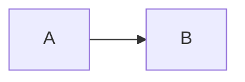

# Portfolio

Static site generated with [Astro](https://astro.build) 7, bilingual (fr/en), deployed on GitHub Pages.

## Setup

```sh
npm install
npx playwright install chromium    # or : export MERMAID_BROWSER=/usr/bin/chromium
npm run dev                        # http://localhost:4321
npm run build && npm run preview
```

## Architecture

```
site.config.ts              identity, languages, URL, active theme
src/content/                ── CONTENT
  projects/<slug>/
    project.yaml            data common to all languages (date, tags, links, image)
    fr.mdx, en.mdx          text for each language (title, abstract, body)
    *.png|svg|...           project images, referenced using relative paths
  cv/cv.yaml                Complete CV, a single source for both languages
src/content.config.ts
src/i18n/ui.ts
src/lib/                    ── LOGIC (assembly, sorting, i18n, URLs)
src/pages/
src/themes/default/         ── DESIGN
  layouts/  views/  components/  mdx/  styles/
```

Routes import the theme via the `@theme` alias. To change the design: copy `src/themes/default` to `src/themes/<name>`, and update `theme` in `site.config.ts` (as well as the `@theme/*` path in `tsconfig.json` for editor support). The content remains unchanged.

**Theme agreement** :

| File                  | Props received                                                        |
|-----------------------|-----------------------------------------------------------------------|
| `views/Home.astro`    | `lang`, `projects: Project[]` (already sorted)                        |
| `views/Project.astro` | `project: Project` (`meta`, `text`, `translated`, `availableIn`)      |
| `views/Cv.astro`      | `lang`, `cv`                                                          |
| `mdx/index.ts`        | exports `components` including at least `Figure`, `Callout`, `Video`  |

## Adding a project

```sh
npm run new -- my-project
```

The folder is created with `draft: true` (visible only in `npm run dev`). The home page is built by listing `src/content/projects/`: there is nothing else to update. If a translation is not ready, simply delete `en.mdx`: the English page will display the French version with a banner.

Sorting the home page: `featured: true` places the project in « Featured », then sort by `order` (descending) and by `date`.

## Blocks available in an `.mdx` file

````mdx
Texte **Markdown** classique, tableaux, listes...


<Figure caption="Légende">


</Figure>

Maths en ligne $E = mc^2$ et en bloc :
$$
\int_0^\infty e^{-x^2}\,dx = \frac{\sqrt\pi}{2}
$$

```cpp title="main.cpp"
int main() {}
```



<Callout type="note">...</Callout>                   <- note | tip | warning
<Video src="https://youtu.be/..." title="Démo" />  <- YouTube ou fichier de public/
````

## CV

`src/content/cv/cv.yaml` powers the `/fr/cv/` and `/en/cv/` pages. A print stylesheet is included
(Ctrl+P generates a clean PDF). To provide a PDF created via LaTeX, place `cv-fr.pdf`/`cv-en.pdf` in the `public/` directory
and specify it under `pdf:` in the YAML file.
