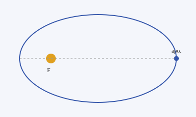
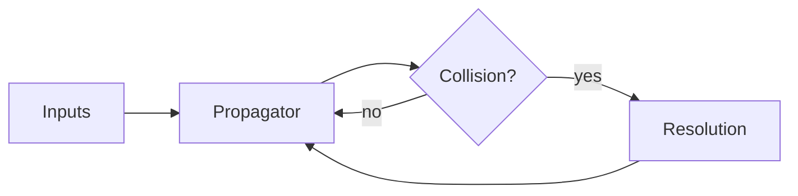

This file shows everything a project page can contain. The text is plain
**Markdown**: *italics*, `inline code`, [links](https://astro.build), lists, tables, etc.

## Image



<Figure caption="The focus F holds the central body.">


</Figure>

## Maths (LaTeX)

Inline: the specific orbital energy is $\varepsilon = -\frac{\mu}{2a}$.

$$
r(\theta) = \frac{a\,(1 - e^2)}{1 + e\cos\theta}
\qquad
T = 2\pi\sqrt{\frac{a^3}{\mu}}
$$

## Code

```cpp title="integrator.hpp"
template <std::floating_point T, std::invocable<T> F>
constexpr void leapfrog(std::span<State<T>> states, F accel, T dt) noexcept {
    for (auto& s : states) {
        s.v += T(0.5) * dt * accel(s.x);
        s.x += dt * s.v;
        s.v += T(0.5) * dt * accel(s.x);
    }
}
```

## Diagram (Mermaid)



<Callout type="note">
  Components such as `Figure`, `Callout` and `Video` come from the theme:
  content only names them, it never imports them.
</Callout>

<Video src="https://www.youtube.com/watch?v=dQw4w9WgXcQ" title="Demo" />
