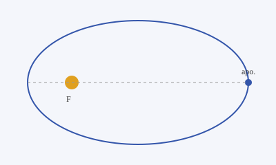
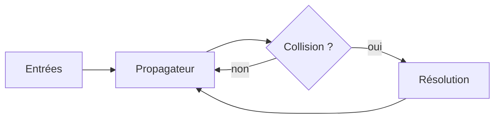

Ce fichier montre tout ce qu'une page de projet peut contenir. Le texte est du
**Markdown** classique : *italique*, `code en ligne`, [liens](https://astro.build),
listes, tableaux, etc.

## Image

Une image locale, placée à côté du fichier, est optimisée au build :



Avec légende, via un composant fourni par le thème :

<Figure caption="Le foyer F est occupé par l'astre central.">


</Figure>

## Mathématiques (LaTeX)

En ligne : l'énergie spécifique d'orbite vaut $\varepsilon = -\frac{\mu}{2a}$.

En bloc :

$$
r(\theta) = \frac{a\,(1 - e^2)}{1 + e\cos\theta}
\qquad
T = 2\pi\sqrt{\frac{a^3}{\mu}}
$$

## Code

```cpp title="integrator.hpp"
#include <concepts>
#include <span>

template <std::floating_point T>
struct State { T x, v; };

// Intégrateur symplectique (leapfrog), sans allocation.
template <std::floating_point T, std::invocable<T> F>
constexpr void leapfrog(std::span<State<T>> states, F accel, T dt) noexcept {
    for (auto& s : states) {
        s.v += T(0.5) * dt * accel(s.x);
        s.x += dt * s.v;
        s.v += T(0.5) * dt * accel(s.x);
    }
}
```

## Diagramme (Mermaid)



## Encadré

<Callout type="note">
  Les composants comme `Figure`, `Callout` ou `Video` sont fournis par le thème :
  le contenu ne les importe pas, il les nomme seulement.
</Callout>

## Vidéo

<Video src="https://www.youtube.com/watch?v=dQw4w9WgXcQ" title="Démo" />
