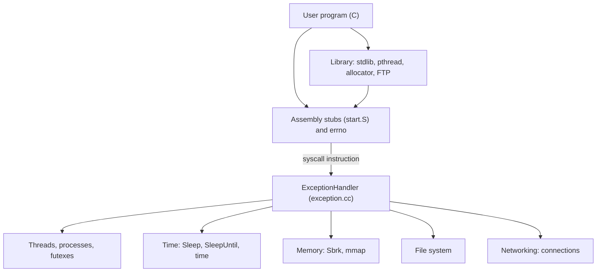

NachOS is a teaching operating system that runs on a simulated MIPS machine. For a four-week Master's project in a team of five, we took the provided base version and turned it into a multi-threaded, multi-process kernel with a file system, networking and a C library. The kernel is written in C++, user programs in C, cross-compiled for MIPS.

{/* TODO: personal motivation: why feature this project in the portfolio? */}

The team had no assigned roles; I worked on most parts and was often first on the bugs. Entirely mine: `errno`, the assembly system call stubs, the time system calls, futexes and atomic operations, and the standard part of the user library. I designed threads and processes with another team member, wrote most of the `pthread` library, and started the mdBook documentation that the whole team then filled in.

{/* TODO: review and confirm the description of my personal share. Should I also mention my work on networking and the file system? Several commits under my name touch them ("Message chunking work", "Syscall fragmentation work", "Enhance Inodes table, some corrections"). */}

## What the project does

- **Threads**: creation, termination, join and detach through a user-space `pthread` library. At most 30 threads per process.
- **Processes**: `ForkExec` runs an executable in a new address space, `ForkJoin` waits for a child and collects its exit code. A memory access error only kills the faulty process.
- **Time**: `Sleep`, `SleepUntil`, `GetCurrentTick`, `time`. Sleeping threads wait in a list sorted by wake-up tick.
- **Memory**: `Sbrk`, `mmap`, `munmap`, and user-space `malloc`/`free`.
- **Synchronisation**: semaphores, then futexes and atomic operations.
- **Files**: directories, variable-size files, indirection blocks for large files.
- **Networking**: TCP-inspired reliable connections on top of the simulator's unreliable network, and a small FTP library.
- **C library**: `printf`, `scanf`, equivalents of `string.h` and `stdlib.h`, per-thread `errno`, and a user-space shell.

A Python script (`test_all.py`), run by GitLab CI, executes the test programs and compares their output with an expected output.

## Architecture



`ExceptionHandler` dispatches each `syscall` to its handler function.

## Technical highlights

### errno, from a negative return code to the `$gp` register

The kernel reports an error by returning the negation of a code (`-E_INVAL`, `-E_FAULT`...). Every system call goes through a stub generated by an assembly macro: if the result is negative, the stub stores its absolute value in `errno` and returns -1. To make `errno` per-thread, it lives in a TLS area whose address the kernel loads into `$gp` when the thread is created. The main thread has no TLS (`$gp` is 0) and uses a global variable. A shortened excerpt of the macros:

```mipsasm title="code/userprog/syscall_macros.S"
    .macro HANDLE_SYSCALL_ERROR
    subu  $3,$0,$2
    beqz  $gp, __errno_global_\@
    nop
    sw    $3, TLS_OFFSET_ERRNO($gp)
    j     __errno_done_\@
    nop
__errno_global_\@:
    sw    $3, __global_errno
__errno_done_\@:
    .endm

    # ...

\name:
    addiu $2,$0,\scno
    syscall
    bgez  $2, __ok_\name
    nop
    HANDLE_SYSCALL_ERROR
    addiu $2,$0,-1
    j     $31
    nop
```

### Futexes and atomic operations under `pthread`

The simulated machine has a single processor, so masking interrupts is enough to prevent any thread switch. `atomic_load`, `atomic_store` and `atomic_cmpxchg` therefore access user memory with interrupts masked.

`futex_wait(addr, expected)` checks, with interrupts masked, that `addr` still holds `expected` before putting the thread to sleep in that address's queue; `futex_wake` wakes up at most *n* of them. Mutexes and `pthread_join` are written in user space on top of these primitives. Excerpt, without the recursive and error-checking mutex cases:

```c title="code/libs/pthread/nos_pthread_mutex.c"
int pthread_mutex_lock(pthread_mutex_t *mutex) {
    if (mutex == NULL) { return E_INVAL; }

    const int self = thread_self();
    // ...

    while (1) {
        if (atomic_cmpxchg(&mutex->state, 0, 1) == 0) {
            mutex->owner = self;
            mutex->count = 1;
            return 0;
        }
        futex_wait(&mutex->state, 1);
    }
}
```

### An allocator carried over from an earlier project

`malloc` relies on an allocator written earlier in the year for another project. The team picked mine; integrating it mostly meant replacing its system calls with the NachOS ones. Each block carries a header and a footer holding its size, with the lowest bit marking free blocks. Free blocks form a doubly linked list, searched with first, best or worst fit. On free, the previous block's footer makes it possible to merge free neighbors. When no block fits, the heap grows through `Sbrk`, in 128-byte pages.

## What I take away from it

{/* TODO: to write: what this project taught me, the difficulties I faced, what I would do differently. */}
