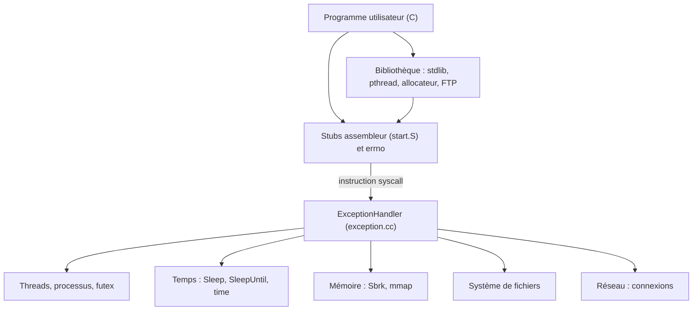

NachOS est un système d'exploitation pédagogique qui tourne sur une machine MIPS simulée. Pour un projet de M1 de quatre semaines, en groupe de cinq, nous avons repris la version de base fournie pour en faire un noyau multi-thread et multi-processus, avec fichiers, réseau et bibliothèque C. Le noyau est en C++, les programmes utilisateurs en C, compilés en croisé pour MIPS.

{/* TODO: motivation personnelle : pourquoi mettre ce projet en avant dans le portfolio ? */}

L'équipe n'avait pas de rôles attribués ; j'ai touché à la plupart des parties, souvent en première ligne sur les bugs. Sont entièrement de moi : `errno`, les stubs assembleur des appels système, les appels système de temps, les futex et les opérations atomiques, et la partie standard de la bibliothèque utilisateur. J'ai conçu les threads et les processus avec une autre personne de l'équipe, écrit l'essentiel de la bibliothèque `pthread`, et lancé la documentation mdBook que toute l'équipe a complétée.

{/* TODO: relire et valider la description de ma part personnelle. Faut-il aussi citer ma participation au réseau et au système de fichiers ? Plusieurs commits à mon nom y touchent (« Message chunking work », « Syscall fragmentation work », « Enhance Inodes table, some corrections »). */}

## Ce que fait le projet

- **Threads** : création, terminaison, join et détachement via une bibliothèque `pthread` en espace utilisateur. 30 threads au plus par processus.
- **Processus** : `ForkExec` lance un exécutable dans un nouvel espace d'adressage, `ForkJoin` attend un enfant et récupère son code de retour. Une erreur d'accès mémoire ne termine que le processus fautif.
- **Temps** : `Sleep`, `SleepUntil`, `GetCurrentTick`, `time`. Les threads endormis attendent dans une liste triée par tick de réveil.
- **Mémoire** : `Sbrk`, `mmap`, `munmap`, et `malloc`/`free` en espace utilisateur.
- **Synchronisation** : sémaphores, puis futex et opérations atomiques.
- **Fichiers** : répertoires, fichiers de taille variable, blocs d'indirection pour les gros fichiers.
- **Réseau** : connexions fiables inspirées de TCP au-dessus du réseau non fiable du simulateur, et une petite bibliothèque FTP.
- **Bibliothèque C** : `printf`, `scanf`, équivalents de `string.h` et `stdlib.h`, `errno` par thread, et un shell utilisateur.

Un script Python (`test_all.py`), lancé par la CI GitLab, exécute les programmes de test et compare leur sortie à une sortie attendue.

## Architecture



`ExceptionHandler` aiguille chaque `syscall` vers sa fonction de traitement.

## Points techniques

### errno, du code négatif au registre `$gp`

Le noyau signale une erreur en renvoyant l'opposé d'un code (`-E_INVAL`, `-E_FAULT`...). Chaque appel système passe par un stub généré par une macro assembleur : si le résultat est négatif, le stub range sa valeur absolue dans `errno` et renvoie -1. Pour que `errno` soit propre à chaque thread, il vit dans une zone TLS dont le noyau place l'adresse dans `$gp` à la création du thread. Le thread principal n'a pas de TLS (`$gp` vaut 0) et utilise une variable globale. Extrait raccourci des macros :

```mipsasm title="code/userprog/syscall_macros.S"
    .macro HANDLE_SYSCALL_ERROR
    subu  $3,$0,$2
    beqz  $gp, __errno_global_\@
    nop
    sw    $3, TLS_OFFSET_ERRNO($gp)
    j     __errno_done_\@
    nop
__errno_global_\@:
    sw    $3, __global_errno
__errno_done_\@:
    .endm

    # ...

\name:
    addiu $2,$0,\scno
    syscall
    bgez  $2, __ok_\name
    nop
    HANDLE_SYSCALL_ERROR
    addiu $2,$0,-1
    j     $31
    nop
```

### Futex et opérations atomiques sous `pthread`

La machine simulée n'a qu'un processeur : masquer les interruptions suffit à empêcher tout changement de thread. `atomic_load`, `atomic_store` et `atomic_cmpxchg` accèdent donc à la mémoire utilisateur interruptions masquées.

`futex_wait(addr, attendu)` vérifie, interruptions masquées, que `addr` contient encore `attendu` avant d'endormir le thread dans la file de cette adresse ; `futex_wake` en réveille au plus *n*. Les mutex et `pthread_join` sont écrits en espace utilisateur sur ces primitives. Extrait, sans les cas des mutex récursifs et avec vérification d'erreur :

```c title="code/libs/pthread/nos_pthread_mutex.c"
int pthread_mutex_lock(pthread_mutex_t *mutex) {
    if (mutex == NULL) { return E_INVAL; }

    const int self = thread_self();
    // ...

    while (1) {
        if (atomic_cmpxchg(&mutex->state, 0, 1) == 0) {
            mutex->owner = self;
            mutex->count = 1;
            return 0;
        }
        futex_wait(&mutex->state, 1);
    }
}
```

### Un allocateur repris d'un projet précédent

`malloc` repose sur un allocateur écrit plus tôt dans l'année pour un autre projet. L'équipe a choisi le mien ; l'intégrer a surtout consisté à remplacer ses appels système par ceux de NachOS. Chaque bloc porte un en-tête et un pied de page contenant sa taille, dont le bit de poids faible marque les blocs libres. Ceux-ci forment une liste doublement chaînée, parcourue en first, best ou worst fit. À la libération, le pied de page du bloc précédent permet de fusionner les voisins libres. Faute de bloc adapté, le tas grandit par `Sbrk`, par pages de 128 octets.


## Ce que j'en retiens

{/* TODO: à écrire : ce que ce projet m'a appris, les difficultés rencontrées, ce que je referais autrement. */}
